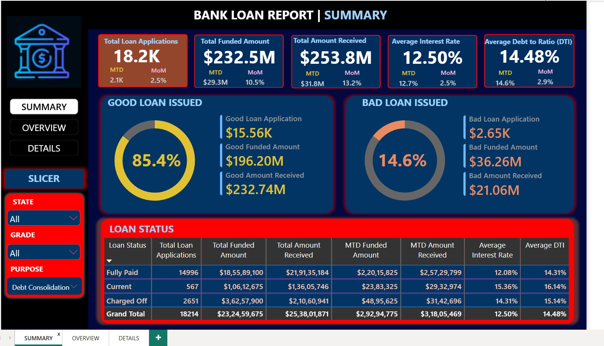
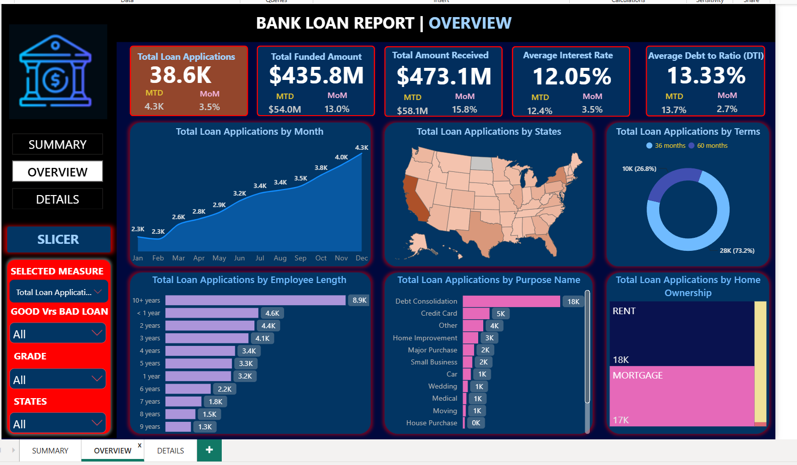
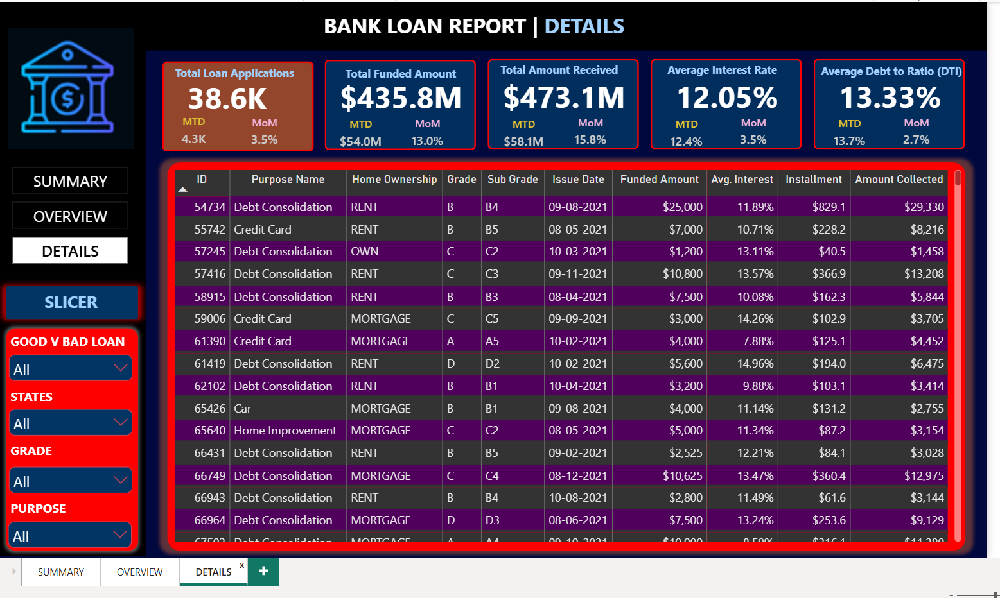
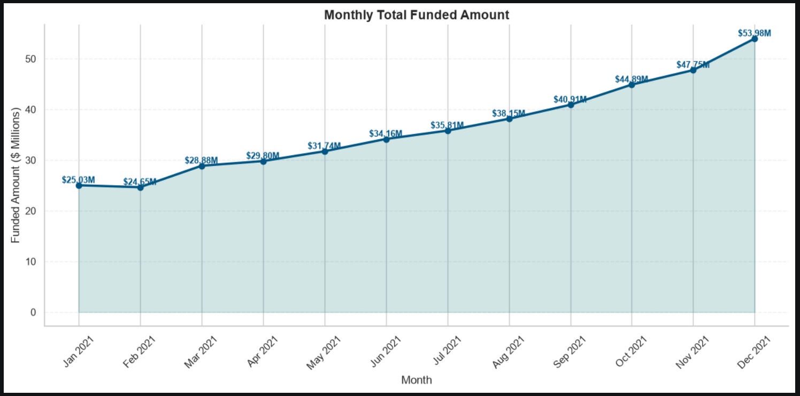
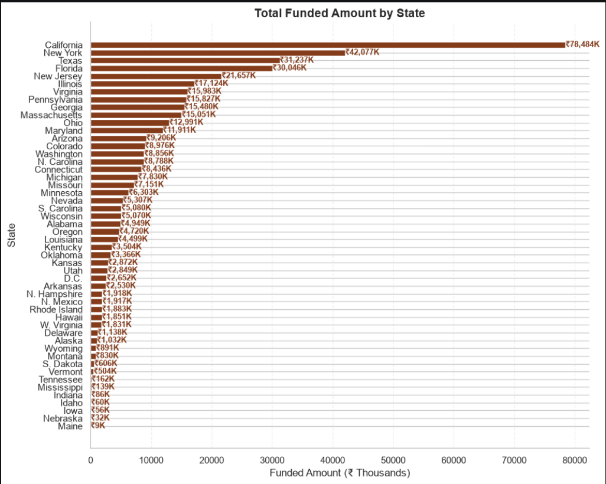
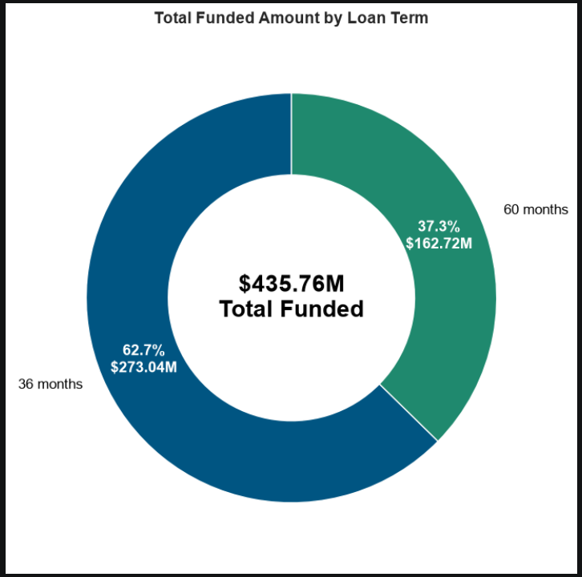
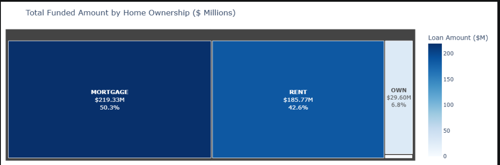

# 🏦 Bank Loan Analytics & Portfolio Risk Intelligence System
### Enterprise Credit Risk, Liquidity Monitoring & BI Reconciliation Pipeline
**Stack:** MySQL · Microsoft Power BI · Python (Pandas, Plotly, Seaborn) · DAX · Excel
[](https://www.mysql.com/)
[](https://powerbi.microsoft.com/)
[](https://www.python.org/)
[](https://learn.microsoft.com/en-us/dax/)
[]()
---
## 📌 Executive Summary
In retail and commercial banking, assessing lending portfolios, managing liquidity, and mitigating credit default risk are foundational to institutional solvency. A mismatch between disbursement rates and debt collections can quickly lead to systemic liquidity contraction.
This project delivers an enterprise **Bank Loan Analytics & Portfolio Risk System** built upon a rigorous **"SQL-First as the Source of Truth"** methodology. Analyzing **38,576 loan transactions across FY2021 totaling $435.76M in funded capital and $473.07M in cash collections**, the project establishes a robust data reconciliation pipeline across **MySQL (37 production queries with CTEs, conditional logic, and window functions)**, **Python exploratory scripts (statistical distributions & Plotly treemaps)**, and an interactive **Power BI 2-Page Executive Dashboard Suite (Summary View & Overview Dimensional Slice-and-Dice)**.
---
## 🖥️ Executive Power BI Dashboard Previews
### 1️⃣ Dashboard 1 — Summary View (C-Suite Lending KPIs & Good/Bad Risk Splits)

### 2️⃣ Dashboard 2 — Overview View (Dimensional Slicing by State, Term, Purpose & Grade)

### 3️⃣ Consolidated Loan Status Grid View

---
## 🐍 Python Exploratory Data Analysis & Statistical Visualizations
In addition to Power BI, comprehensive exploratory statistical modeling was developed in Python (`Bank Loan Analysis.ipynb`) using **Matplotlib, Seaborn, and Plotly**:
### 1️⃣ Monthly Funded Amount Trajectory (Seaborn Spline with Shaded Area)

### 2️⃣ Regional Exposure & State-wise Capital Allocation

### 3️⃣ Portfolio Distribution by Loan Term (36 vs 60 Months Donut)

### 4️⃣ Borrower Home Ownership Capital Exposure (Interactive Plotly Treemap)

---
## 📊 Core Portfolio & Financial KPI Snapshot
| Metric Category | Key Performance Indicator (KPI) | Portfolio Value | December (MTD) | MoM Growth % | Strategic / Business Significance |
| :--- | :--- | :--- | :--- | :--- | :--- |
| **Lending Volume** | **Total Loan Applications** | **38,576 loans** | **4,314 loans** | **+6.91%** | Highest single-month origination surge |
| **Capital Outflow** | **Total Funded Amount** | **$435,757,075** | **$53,981,425** | **+13.04%** | Accelerated disbursement momentum into Q4 |
| **Cash Inflow** | **Total Amount Received** | **$473,070,933** | **$58,074,380** | **+15.84%** | Strong net liquidity margin (+$37.31M net cash flow) |
| **Portfolio Yield** | **Average Interest Rate** | **12.049%** | **12.356%** | **+3.47%** | Margin expansion driven by higher-yield loans |
| **Solvency Metric** | **Average Debt-to-Income (DTI)** | **13.327%** | **13.666%** | **+2.727%** | Conservative borrowing profile well below 20% risk benchmark |
| **Quality Tier** | **Good Loan Applications (Share)**| **86.18% (33,243)**| — | — | Fully Paid & Current healthy assets |
| **Quality Capital** | **Good Loan Cash Surplus** | **+$65.56M Net** | $370.22M Funded | $435.79M Collected | Core institutional profit driver |
| **Default Risk** | **Bad Loan Applications (Share)** | **13.82% (5,333)** | — | — | Charged-Off non-performing loan cohort |
| **Capital Impairment**| **Bad Loan Capital Exposure** | **$65,532,225** | $37,284,763 Recvd | **-$28.25M Loss** | **56.9% recovery ratio** requiring loss-provision hedging |
---
## 🛠️ Data Architecture & Analytical Workflow
```text
financial_loan Raw Transactional Ledger (38,576 records)
                       │
       ┌───────────────┴───────────────┐
       ▼                               ▼
[MySQL Analytical Engine]    [Python EDA Pipeline]
 • STR_TO_DATE parsing        • Data cleaning & missing values
 • CTEs & CROSS JOIN MoM%     • Distribution plots & Seaborn
 • CASE WHEN conditional agg  • Plotly interactive treemaps
 • 37 Validated queries       • State & purpose mappings
       │                               │
       └───────────────┬───────────────┘
                       ▼
    [Power BI Modeling & BI Reconciliation]
     • Star Schema & Time Intelligence DAX
     • Reconciled 100% against SQL truth
     • Summary KPI View & Overview Deep-Dive

  

  
💻 SQL Engineering & Analytical Implementation

  
1. Robust Date Parsing Workaround (Handling Text Timestamps)

  

The raw dataset stores issue_date as TEXT in DD-MM-YYYY format (e.g. "12-12-2021"). Native MySQL functions like MONTH() silently fail on raw text strings without error. To prevent catastrophic silent bugs, all temporal queries use:


  
sql
STR_TO_DATE(issue_date, '%d-%m-%Y')

  
2. Multi-Period MoM CTE Pattern

  
sql
WITH mtd AS (
    SELECT SUM(loan_amount) AS MTD
    FROM financial_loan
    WHERE MONTH(STR_TO_DATE(issue_date, '%d-%m-%Y')) = 12
      AND YEAR(STR_TO_DATE(issue_date, '%d-%m-%Y')) = 2021
),
pmtd AS (
    SELECT SUM(loan_amount) AS PMTD
    FROM financial_loan
    WHERE MONTH(STR_TO_DATE(issue_date, '%d-%m-%Y')) = 11
      AND YEAR(STR_TO_DATE(issue_date, '%d-%m-%Y')) = 2021
)
SELECT 
    CONCAT(ROUND((MTD - PMTD) / PMTD * 100, 2), '%') AS MoM_Funded_Amount
FROM mtd
CROSS JOIN pmtd;
-- Result: 13.04% Month-over-Month Capital Expansion

  
3. Conditional Loan Health Segmentation

  
sql
WITH CTE AS (
    SELECT 
        COUNT(CASE WHEN loan_status IN ('Fully Paid', 'Current') THEN id END) AS Good_Loan_Applications,
        COUNT(CASE WHEN loan_status = 'Charged Off' THEN id END) AS Bad_Loan_Applications,
        COUNT(id) AS Total_Applications
    FROM financial_loan
)
SELECT 
    CONCAT(ROUND((Good_Loan_Applications / Total_Applications) * 100, 2), '%') AS Good_Loan_Percentage,
    CONCAT(ROUND((Bad_Loan_Applications / Total_Applications) * 100, 2), '%') AS Bad_Loan_Percentage
FROM CTE;
-- Result: 86.18% Good vs 13.82% Bad Loans

  

  
🔍 Key Business Findings & Portfolio Insights

  

  
Year-End Lending Expansion: December was the highest performing month of the year with 4,314 applications (+6.91% MoM), 
53.98
𝑀
𝑓
𝑢
𝑛
𝑑
𝑒
𝑑
(
+
13.04
53.98Mfunded(+13.0458.07M collected (+15.84% MoM).

  
The 
28.25
𝑀
𝐶
ℎ
𝑎
𝑟
𝑔
𝑒
𝑑
−
𝑂
𝑓
𝑓
𝐶
𝑎
𝑝
𝑖
𝑡
𝑎
𝑙
𝐿
𝑒
𝑎
𝑘
:
∗
∗
𝐵
𝑎
𝑑
𝑙
𝑜
𝑎
𝑛
𝑠
𝑎
𝑐
𝑐
𝑜
𝑢
𝑛
𝑡
𝑓
𝑜
𝑟
∗
∗
13.82
28.25MCharged−OffCapitalLeak:∗∗Badloansaccountfor∗∗13.8265.53M funded), but the bank only managed to recover 
37.28
𝑀
(
56.9
37.28M(56.928.25M.

  
Product Duration Dominance: 36-month loan terms comprise 73.2% of applications (28,237 loans), indicating borrower preference for rapid debt clearance over lower monthly payments.

  
Purpose Concentration: Debt Consolidation represents the overwhelming majority of funding, followed by Credit Card refinancing. Borrowers are primarily leveraging bank credit to restructure existing liabilities.

  
Regional Exposure: California (CA), New York (NY), and Texas (TX) constitute the largest geographic concentrations of funded capital.

  

  

  
🎯 Strategic Banking Recommendations

  

  
Tighten Credit Tiering for High DTI & Low Grade Borrowers: Restrict unsecured lending limits for grades E, F, and G where charge-off rates spike.

  
Implement Early Warning Collection Signals: Track repayment lag at Day 30 and Day 60 to initiate restructuring before loans reach default status.

  
Capitalize on 36-Month Loan Term Velocity: Create tailored lower-rate incentives for short-duration borrowers who consistently demonstrate lower delinquency rates.

  

  

  
📂 Repository Structure

  
text
bank-loan-analysis-sql-powerbi-python/
│
├── bank_loan_data.pbix                                              # Master 2-Page Power BI Executive Dashboard
├── bank_loan_sql_query.sql                                          # 37 Production MySQL validation & KPI queries
├── Bank Loan Analysis.ipynb                                         # Python exploratory data analysis & visualization script
├── financial_loan.csv                                               # Complete transactional dataset (38,576 records)
├── Bank_Loan_Analysis_SQL_MySQL_Professional_Project_Report_v2.docx # In-depth 16-section executive project report
├── Domain Knowledge Doc.docx                                        # Banking domain, risk lifecycle, and compliance guide
│
├── dashboard_summary_view.png                                       # Power BI View 1: Executive KPI summary preview
├── dashboard_overview_view.png                                      # Power BI View 2: Dimensional slice-and-dice preview
├── dashboard_details_grid.png                                       # Power BI View 3: Loan status grid preview
│
├── python_monthly_trend.png                                         # Python Viz 1: Monthly funded trend spline
├── python_state_funding.png                                         # Python Viz 2: State-wise capital horizontal bars
├── python_term_donut.png                                            # Python Viz 3: 36 vs 60 Month term donut chart
├── python_homeownership_treemap.png                                 # Python Viz 4: Home ownership interactive treemap
│
├── requirements.txt                                                 # Python libraries (Pandas, Plotly, Seaborn, MySQL connector)
├── .gitignore                                                       # Ignores temp caches, Excel locks (~$*), and checkpoints
└── README.md                                                        # Master portfolio project pitch deck & technical specs

  

  
🚀 How to Run & Replicate

  

  

  

Clone the Repository:


  
bash
git clone https://github.com/ravinder0710/bank-loan-analysis-sql-powerbi-python.git
cd bank-loan-analysis-sql-powerbi-python

  

  

  

Execute MySQL Queries:


  

  
Open MySQL Workbench or your favorite SQL client.

  
Run bank_loan_sql_query.sql to generate all 37 analytical tables and MTD/PMTD metrics.

  

  

  

  

Open Power BI Dashboard:


  

  
Launch Microsoft Power BI Desktop.

  
Open bank_loan_data.pbix and refresh connection to your MySQL instance or source CSV.

  

  

  

  

Run Python Exploratory Analysis:


  
bash
pip install -r requirements.txt
jupyter notebook "Bank Loan Analysis.ipynb"

  

  

  

  
👨‍💼 Author & Contact

  

Ravinder Gupta

  Data Analyst | Business Intelligence & SQL Analytics Specialist


  

  
📍 Location: Alwar, Rajasthan, India

  
📧 Email: iamravindergupta17@gmail.com

  
💬 WhatsApp: +91 9982637026

  
💼 LinkedIn: linkedin.com/in/ravinder-gupta-da

  
🐙 GitHub: github.com/ravinder0710
